# Esquadro

[](https://github.com/LimaJoota/esquadro/actions/workflows/ci.yml) [](LICENSE)

Ask for a sketch, get one that explains. A [Claude Code](https://claude.com/claude-code) skill for hand-style drawings in pencil, pen and watercolour, and for the technical figures that support a document. Self-contained SVG, checked for overlapping text and stray lines before you see it.

*Esquadro* is Portuguese for a drafting set square.

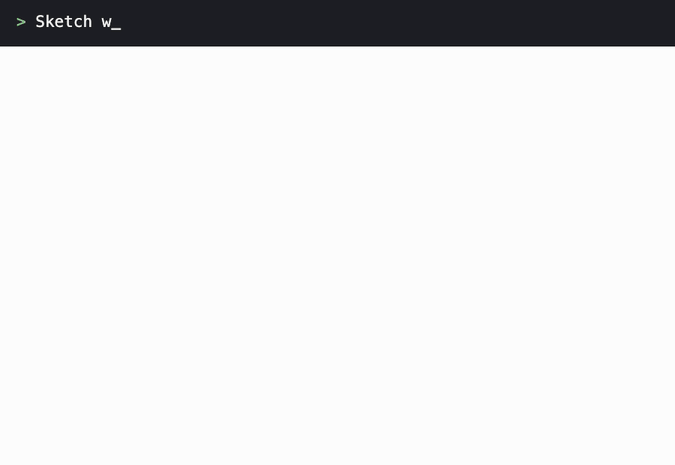

<sub>Built up in stages for illustration; not a screen recording.</sub>

> **Em português:** skill para fazer croquis que explicam as coisas e figuras que dão suporte a documentos técnicos, a lápis, com caneta vermelha e azul e aquarela. Tem chamadas numeradas, notas à mão, sequência em quadros, certo e errado, volumes em perspectiva, pessoas e objetos, e figuras numeradas para o documento. Para quando a medida importa, tem também folhas técnicas com escala e cotas calculadas. O validador pega texto sobre texto, traço cortando texto e elemento fora da folha, e a skill manda sempre olhar a imagem antes de entregar. Instale com os comandos abaixo e peça "faz um croqui explicando...". Veja [BACKLOG.md](BACKLOG.md) (em português).

## Install

```bash
claude plugin marketplace add LimaJoota/esquadro
```

```bash
claude plugin install esquadro@esquadro
```

Or copy it straight into your skills folder:

```bash
git clone https://github.com/LimaJoota/esquadro ~/.claude/skills/esquadro
```

Then ask for a drawing: *"sketch how to assemble this pipe joint, in three steps"* or *"faz um croqui mostrando por que precisa calçar a pilha, para o relatório"*.

If you run hundreds of other skills, Claude Code may list them without their descriptions, and this one will not start by itself. Ask for it by name: *"use the esquadro skill to..."*.

Needs Python 3.10 or later, standard library only. Rendering and the most accurate text check use a local Chrome, Chromium or Edge. Without one, the validator falls back to bundled font metrics and says so.

## One prompt, one run

> Draw a sketch that explains how a toilet flush tank works, for a home maintenance manual.

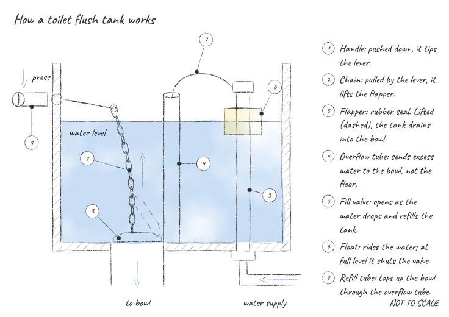

Unedited output from a single run. The skill started by itself; nothing in the prompt names it. [The SVG](examples/from_prompt/flush_tank.svg) passes the validator with no errors or warnings.

## Sketches that explain

The form follows from what the reader must understand. All of these are in [`examples/`](examples), with their scripts. Content is generic and illustrative.

**Working out a load, in plain pencil**

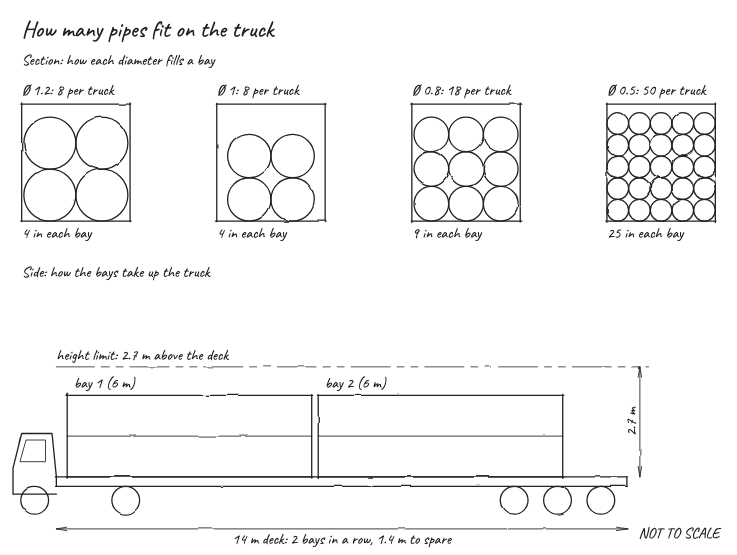

**How something is laid out, and what each part does**

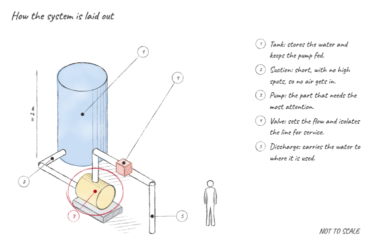

| How to do it, in order | Why one way is better |
|---|---|
| 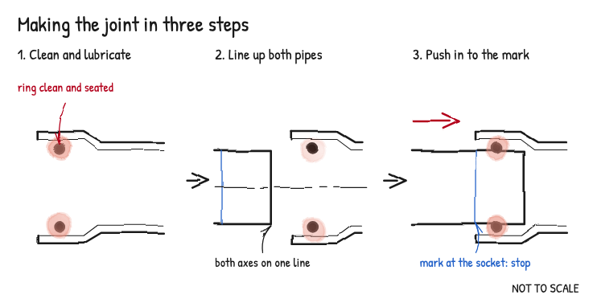 | 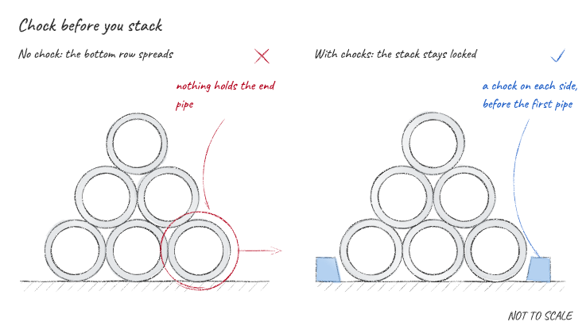 |

| Who does what | Why it works |
|---|---|
| 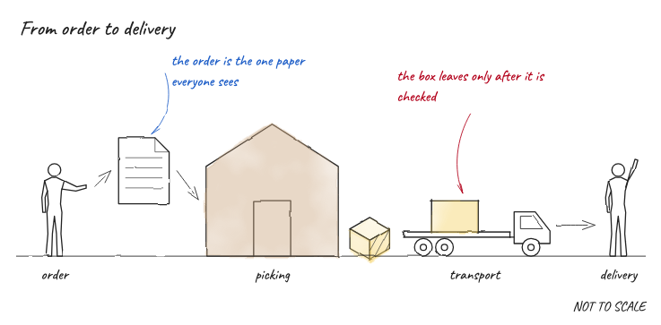 | 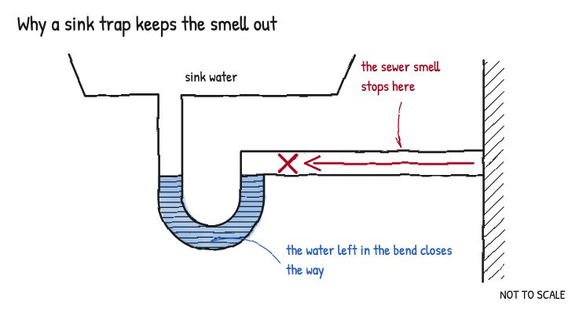 |

## Colour that survives the printer

Pencil is the base. Red pen marks the problem and blue pen the right way, and a watercolour wash separates what the reader must tell apart. In a black-and-white print, the tones stay apart and each mark keeps its shape, so the drawing still reads. `render.py --gray` shows you that print before you make it.

```python
ring(d, pump["side"], 13, 11, ink="red")           # pen
hand_note(d, target, at, "the way out", ink="blue")
iso.cylinder(a, b, r=15, color="blue")             # watercolour
d.wash(outline, "yellow")
```

## Before and after

An SVG written by hand has the faults you would expect, and they are easy to miss in the code. Here the validator's `--annotate` option has ringed them:

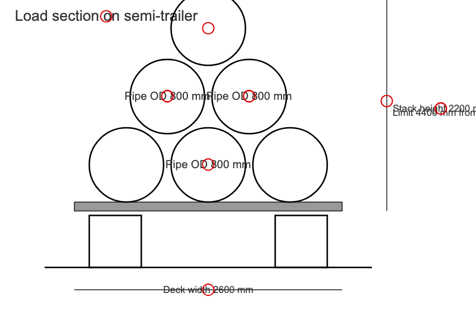

```text
ERROR   TEXT_OVERLAP       "Pipe OD 800 mm" overlaps "Pipe OD 800 mm"
ERROR   TEXT_CROSSED       circle crosses "Load section on semi-trailer" near (142.8, 22.0)
ERROR   TEXT_CROSSED       line crosses "Deck width 2600 mm" near (280.0, 390.1)
ERROR   OUT_OF_BOUNDS      line extends to (519.5, -12.5)-(520.5, 284.5) on a 640x420 canvas
ERROR   NO_SCALE           no scale printed and no "sem escala / not to scale" notice; a reader will measure it
FAIL naive_cargo.svg: 12 errors, 1 warnings (7 texts, 13 shapes, text measured by browser)
```

The same subject from a script, where each height is calculated from the pipe diameter and stacking pattern:

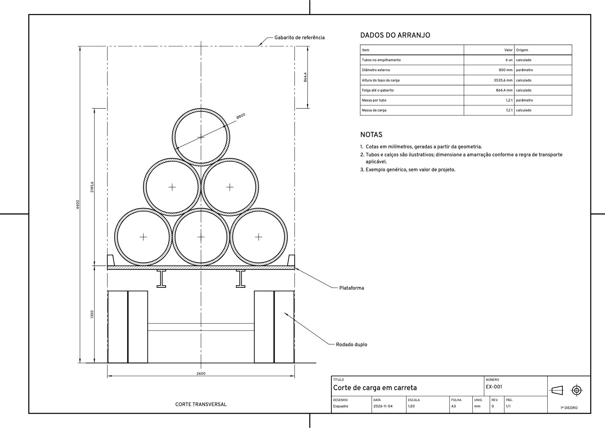

## Technical figures

For when the drawing will be used to measure or build. Each comes in a sheet and in a sketch, from the same geometry.

| Technical or industrial | Sketch |
|---|---|
|  | 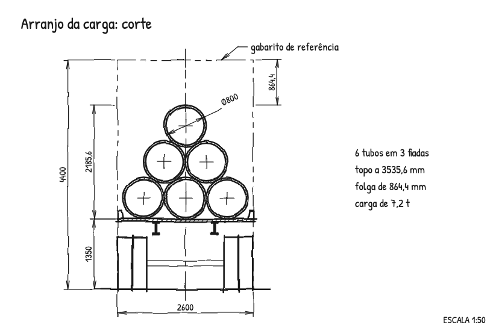 |
| 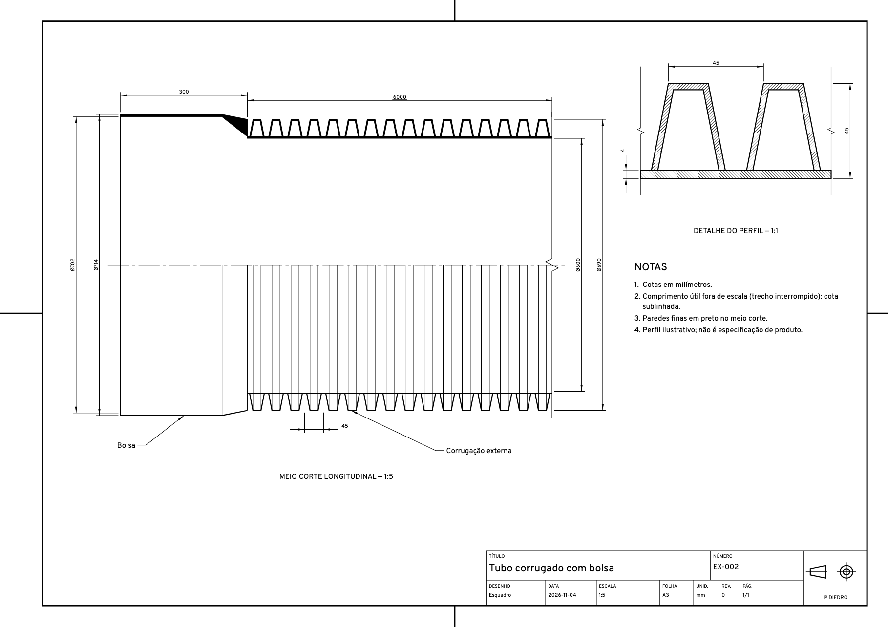 | 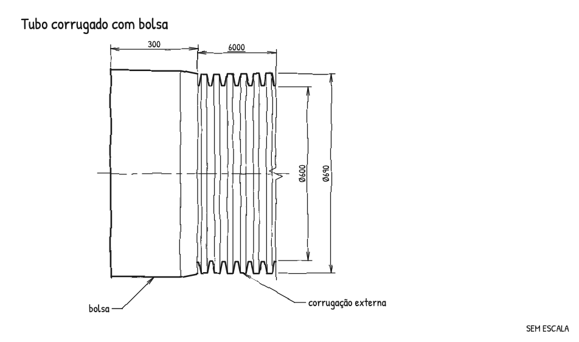 |
| 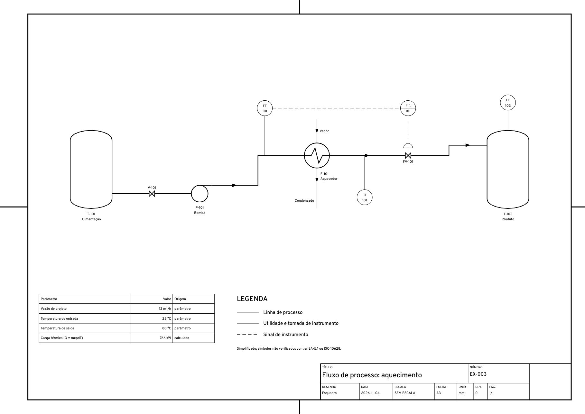 | 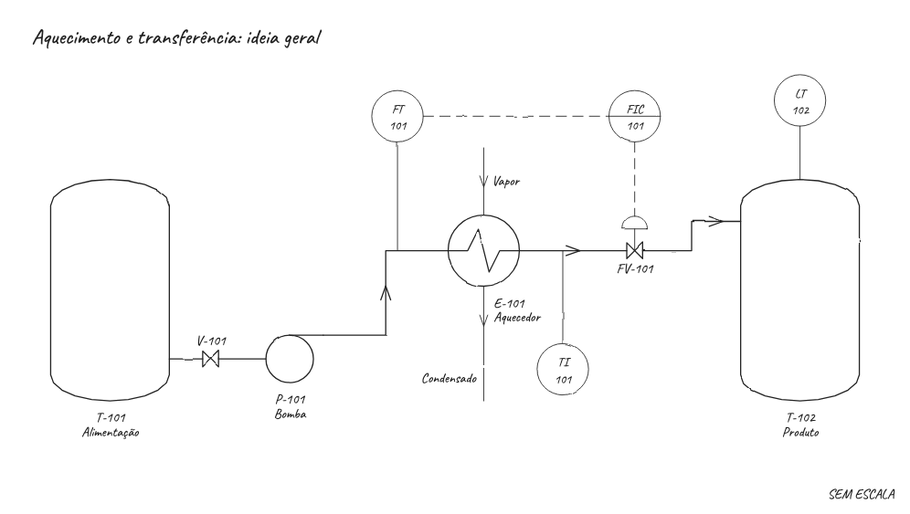 |

## What it does

- **Tools for explaining.** Numbered callouts with a legend, hand notes with curved arrows, frames for steps and comparisons, right and wrong marks, a loop around what matters, free spans such as "≈ 2 m", and three levels of finish.
- **Things to draw with.** Boxes and cylinders in isometric perspective with hand shading, people, a truck, a building and a document.
- **Fits in a document.** Figures sized to the A4 text width or half of it, with numbering and cross-references in HTML that stands alone.
- **Pen and watercolour.** Red and blue inks, and washes that bleed at the edges and pool like pigment, with a flat fallback for programs that ignore SVG filters.
- **A pencil that holds up close.** Each stroke varies in pressure and tapers at the ends, and the paper's grain breaks the line, with a handwritten font chosen so the digits are unambiguous.
- **Technical and industrial modes.** Clean strokes, thick and thin line weights, sheets with frame and title block, first-angle symbol, and a small set of process symbols with named ports and orthogonal connections.
- **Dimensions from geometry.** A dimension measures the points it is given, through the view's scale. A stated value that disagrees raises an error unless it is marked not to scale, which underlines it. The validator re-checks printed numbers against the drawn lines, so a hand edit is caught too.
- **Scale is declared or disclaimed.** The largest standard ratio that fits is chosen by calculation, or the drawing prints "SEM ESCALA" / "NOT TO SCALE".
- **Self-contained output.** The font is embedded as a subset. There are no scripts or external files, and hatching is real clipped lines. It works inline in HTML, through ``, and through Chrome's PDF.
- **A validator for any SVG**, hand-written ones included: overlapping text, strokes through text, elements off the page or sheet frame, external references, missing scale, small or faint text, colors that look alike in black and white. It handles nested transforms, `<use>`, tspans, simple CSS and all path commands, and measures text with a real browser when it can.
- **A method.** The skill tells Claude to start from what the reader must understand, then validate, render and look at the image before delivering, and to say what was assumed.

```bash
python3 scripts/validate.py drawing.svg --annotate ringed.svg
```

```bash
python3 scripts/render.py drawing.svg drawing.png --gray
```

## How it compares

Use the tool that fits. Licenses as checked on 2026-11-04.

| Project | Good at | When to prefer Esquadro |
|---|---|---|
| [draw.io skill](https://github.com/jgraph/drawio-mcp) (Apache-2.0) | Editable diagrams with large symbol libraries | Scale, computed dimensions, checked output. Prefer draw.io when people must edit by hand |
| [Excalidraw skill](https://github.com/coleam00/excalidraw-diagram-skill) (no license file) | Whiteboard-style diagrams | Measured drawings, printing |
| [tldraw](https://github.com/tldraw/tldraw) (own license) | Canvas SDK for apps | Static files, no app |
| [archify](https://github.com/tt-a1i/archify) (Apache-2.0) | Software architecture and flow diagrams as interactive HTML | Physical objects. Use archify for systems |
| [Prancheta](https://github.com/JoaoVictor-C/Prancheta) (MIT) | General figures with a render, inspect and repair loop; the closest in spirit | Drafting conventions: scale, sheets, dimensions, sections |
| [CadQuery](https://github.com/CadQuery/cadquery) (Apache-2.0), [FreeCAD](https://github.com/FreeCAD/FreeCAD) (LGPL-2.1), [OpenSCAD](https://github.com/openscad/openscad) (GPL) | True 3D solids and manufacturing data | Annotated 2D figures for documents. Use these when the 3D model matters |
| [schemdraw](https://github.com/cdelker/schemdraw) (MIT) | Electrical schematics in Python | Mechanical and process figures. Use it for circuits |
| [rough.js](https://github.com/rough-stuff/rough) (MIT) | Hand-drawn graphics in JavaScript | No JavaScript at any stage, plus dimensioning |

Esquadro is younger and narrower than all of these. No code was copied from any of them.

## Limits, plainly

- **Not a CAD system.** It produces 2D figures from scripts, with no 3D model behind them and no DXF yet.
- **The perspective is simple.** Solids are painted far to near, with no automatic hiding, and only boxes and cylinders. The set of ready objects is small.
- **A sketch can explain something wrong.** The drawing is checked for legibility, not for whether its content is true.
- **Not certified to any standard.** Conventions are applied from open sources, and doubts are recorded in [references/standards.md](references/standards.md). Review against the purchased standard when a contract asks for conformity.
- **Process symbols are simplified** and unverified against ISA-5.1 or ISO 10628. Not for issuing a P&ID.
- **Rendering tested in Chrome only.** Other browsers, Inkscape and office programs have not been tried, nor a real printer.
- **In Chrome's PDF the graphite and watercolour filters become images** (about 290 dpi in testing), lettering included. `wobble="geometry"` keeps everything vector, without the grain and with flat washes.
- **The validator misses things a person sees**, such as a leader running through an object or a cramped layout. That is why the skill also makes Claude look.

The plan to close these is in [BACKLOG.md](BACKLOG.md).

## Development

```bash
pip install pytest && python3 -m pytest
```

```bash
python3 examples/build_all.py
```

## License

Code and examples: [MIT](LICENSE). Bundled fonts, under the SIL Open Font License 1.1 and subset for size: [Overpass](assets/fonts/OFL-overpass.txt) and [Caveat](assets/fonts/OFL-caveat.txt). Generated drawings embed these fonts, which the OFL allows. Your drawings are yours.
